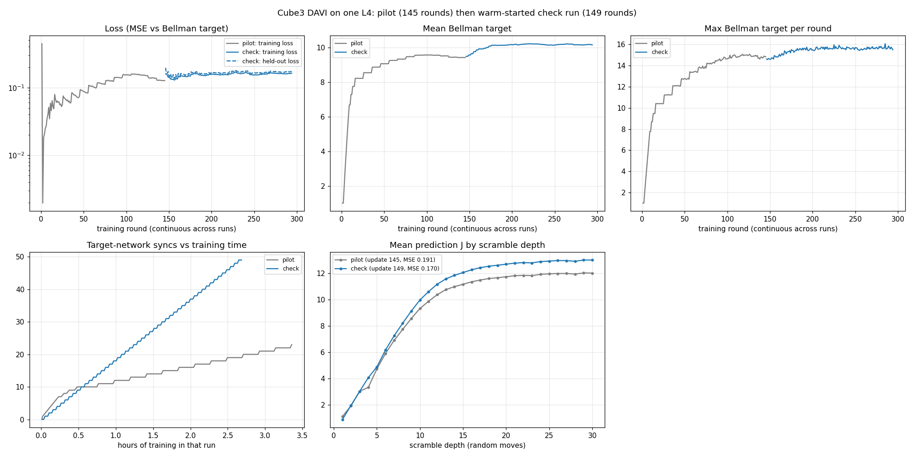

# Training learned heuristics (DeepCubeA-style)

How to train, export, ship and use a cost-to-go network for any puzzle that implements
`Encodable`. Theory: [`theory/deepcubea.md`](theory/deepcubea.md). Decisions:
[ADR 0005](decisions/0005-learned-heuristics-as-heuristics.md) (networks are heuristics),
[ADR 0008](decisions/0008-rust-owns-learned-encodings.md) (encodings and weights format),
[ADR 0009](decisions/0009-training-launchers.md) (cloud launchers).

The method is due to Agostinelli, McAleer, Shmakov and Baldi, *Solving the Rubik's cube
with deep reinforcement learning and search*, Nature Machine Intelligence 2019 [Ago19].
Everything here (DAVI, the residual network shape, BWAS) follows that paper; deviations
are listed at the end.

## TL;DR

```bash
# 0. One-off setup (CPU is fine for the 2x2x2)
pip install -r training/requirements.txt
cargo build --release --features gpss-cli/learn      # `gpss` with ONNX inference

# 1. Use the shipped 2x2x2 network
./target/release/gpss solve --scramble "R U2 F' R2 U F2 R' U' F R2 U" \
    --solver bwas --weights weights/cube2/cube2-davi-v1.json --lambda 0.6 --batch-size 100

# 2. Train your own (resumable; ~2 h on 8 CPU cores for the shipped config)
./target/release/gpss train train --puzzle cube2 --run-dir training/runs/cube2 --updates 400
./target/release/gpss train export --checkpoint training/runs/cube2/checkpoint.pt \
    --out weights/cube2/my-net

# 3. Evaluate exactly against the full 2x2x2 state space
./target/release/gpss evaluate --weights weights/cube2/my-net.json --lambda 0.6 --batch-size 100

# 4. Plan a cloud run (dry run: prints cost estimate + exact commands, launches nothing)
./target/release/gpss train launch aws --bucket s3://my-bucket/gpss --budget-usd 5
```

`gpss train <args>` is a thin wrapper for `python3 -m gpss_train <args>` with
`PYTHONPATH=training` and `GPSS_BIN` set to the running binary; you can call the Python
module directly from `training/` instead.

## Pieces and where they live

| piece | location | language |
|-------|----------|----------|
| state encoding (`Encodable`, `EncodingSpec`) | `crates/gpss-core/src/encode.rs`, per puzzle in `gpss-puzzles` | Rust |
| training data generator (`gpss scramble-data`) | `crates/gpss-learn/src/data.rs` | Rust |
| weights manifest + checksum validation | `crates/gpss-learn/src/manifest.rs` | Rust |
| ONNX inference (`OnnxHeuristic`, feature `onnx`) | `crates/gpss-learn/src/onnx.rs` | Rust |
| batch weighted A* (`BatchWeightedAStar`) | `crates/gpss-core/src/search/bwas.rs` | Rust |
| exact evaluation (`gpss evaluate`) | `crates/gpss-learn/src/eval.rs` | Rust |
| network, DAVI loop, ONNX export | `training/gpss_train/{model,davi,export}.py` | Python |
| launchers (`local`, `aws`, `gcp`) | `training/gpss_train/launch/` | Python |
| shipped weights | `weights/<puzzle>/<name>.{onnx,json}` | data |

## How the encoding stays in sync

Rust is the single source of truth (ADR 0008). Python never implements a puzzle:

1. `Encodable::encode` maps a state to `len` categorical features in `0..classes`
   (2x2x2: 8 corner slots, feature `3 * piece + twist`, 24 classes; key
   `cube2/corner-cubie/v1`).
2. `gpss scramble-data --puzzle cube2 --count N --min-scramble 1 --max-scramble K` writes a
   JSON header line (`format: gpss-davi-data`, the `EncodingSpec`, move names, array
   shapes) followed by raw `u8` arrays: `states [N, len]`, `children [N, moves, len]`,
   `child_is_goal [N, moves]`, `is_goal [N]`, `scramble_depth [N]`.
3. The trainer reads those bytes, stores the encoding spec in its checkpoint, and the
   exporter copies it into the manifest.
4. `OnnxHeuristic::load` compares the manifest's spec with `puzzle.encoding()` field by
   field, and the ONNX file with the manifest's SHA-256, and refuses on any mismatch.

**If you change an encoding, bump `EncodingSpec::version`.** Old weights then fail to load
instead of silently producing garbage.

### Making a new puzzle trainable

1. Implement `gpss_core::Encodable` for it (keep `len * classes` modest; the network
   one-hot-expands internally).
2. Add a `--puzzle` arm to `gpss scramble-data` / `gpss solve` / `gpss evaluate` in
   `gpss-cli` (one line each once the puzzle is in the CLI).
3. Add a preset to `PRESETS` in `training/gpss_train/davi.py`: at least `max_scramble`
   (should exceed the puzzle's diameter or typical optimal length; DeepCubeA used 30 for the
   3x3x3), and larger `hidden1/hidden2/blocks` for big puzzles (the paper's 3x3x3 net is
   5000 / 1000 / 4 blocks).
4. Train, export, evaluate. No other Python change is needed.

## The trainer (`gpss_train train`)

DAVI as in [Ago19]:

- each **update** draws `states_per_update` states scrambled `k ~ U{min..max}` moves from
  the goal (fresh data every update), with all successors;
- targets `y(s) = min_a [1 + J'(A(s,a))]` with `J'(goal) = 0`, `y(goal) = 0`, from the
  frozen target network `J'` (zero before the first sync); negative `J'` outputs are
  clamped to 0;
- `iters_per_update` Adam steps of `batch_size` on MSE;
- if the update's loss is below `loss_threshold` (0.05, as in the paper), `J' <- J`;
  as a fallback, also after `max_updates_per_sync` (10) updates without a sync (logged as
  `forced_sync`). `sync_metric` picks the loss: `train` (mean training loss, the default)
  or `fresh` (the network's MSE on the first `fresh_states` of this update's new states,
  measured before training on them; logged every update as `fresh_loss`).

Distances propagate one move per sync, so the target maximum `y_max` in the log climbs by
about one per sync until it reaches the puzzle's diameter (11 for the 2x2x2 in the
half-turn metric). After that, further updates refine accuracy.

Main options (all have defaults; `--help` lists them):

| option | default | meaning |
|--------|---------|---------|
| `--puzzle` | `cube2` | must be supported by `gpss scramble-data` |
| `--run-dir` | `runs/<puzzle>` | checkpoint, `log.jsonl`, `config.json` |
| `--updates` | 400 | number of DAVI updates |
| `--states-per-update` | 100000 | fresh scrambled states per update |
| `--iters-per-update` / `--batch-size` | 250 / 1000 | Adam steps per update and minibatch |
| `--min-scramble` / `--max-scramble` | 1 / 14 (cube2) | scramble depth range |
| `--loss-threshold` | 0.05 | target-network sync threshold |
| `--max-updates-per-sync` | 10 | force a sync after this many updates without one (0 = never) |
| `--sync-metric` / `--fresh-states` | `train` / 100000 | loss used by the sync rule; held-out states per update |
| `--init-from` | none | warm-start a new run from a checkpoint (weights only; local path, or `gs://` / `s3://` on cloud) |
| `--hidden1` `--hidden2` `--blocks` | 512 256 3 | network size |
| `--lr` `--lr-decay` | 1e-3, 0.9999993 | Adam LR, per-step exponential decay |
| `--threads` | all | torch intra-op threads |
| `--resume` | off | continue from `run_dir/checkpoint.pt` |

Output: `run_dir/checkpoint.pt` (written atomically after every update),
`run_dir/log.jsonl` (one JSON record per update: loss, syncs, target mean/max, timings).

### Network

`CostToGo` (`model.py`): one-hot input -> `hidden1` -> `hidden2` -> `blocks` residual
blocks of width `hidden2` -> scalar, batch norm + ReLU, i.e. the DeepCubeA shape at a
smaller size. The one-hot first layer is an embedding sum (identical maths, no one-hot
tensor), exported to ONNX as Gather + ReduceSum. ONNX input `state: int64[batch, len]`,
output `cost_to_go: float32[batch]`.

## Export and the weights manifest (`gpss_train export`)

Writes `<out>.onnx` (opset 18, dynamic batch) and `<out>.json`, and checks ONNX Runtime
output against PyTorch on random inputs (max abs diff < 1e-3). Manifest fields:

```json
{
  "format": "gpss-weights", "format_version": 1, "name": "cube2-davi-v1",
  "encoding": {"puzzle": "cube2", "scheme": "corner-cubie", "version": 1, "len": 8, "classes": 24},
  "model": {"file": "cube2-davi-v1.onnx", "sha256": "...", "input": "state", "output": "cost_to_go", "opset": 18},
  "architecture": {"type": "resmlp-onehot", "hidden1": 512, ...},
  "training": {"method": "DAVI ...", "config": {...}, "updates": 400, "target_syncs": ..., ...},
  "evaluation": {...},
  "references": ["F. Agostinelli, ... 2019 ..."]
}
```

`--evaluation report.json` embeds an evaluation summary. If you edit the ONNX file you
must re-export (the checksum will no longer match).

## Inference

- Build with `--features gpss-cli/learn` (or depend on `gpss-learn` with feature `onnx`).
  The default build has no ONNX dependency.
- ONNX Runtime (>= 1.22) is loaded at run time from `$ORT_DYLIB_PATH`, else from the
  Python `onnxruntime` package, else the system library path.
- `gpss solve [--puzzle cube2|cube3] --solver bwas --weights <manifest.json> [--lambda L]
  [--batch-size N] [--threads T]`. `--weights` also accepts the `.onnx` (the manifest is
  found next to it), and the manifest's encoding must match the puzzle's (a 2x2x2 network
  is refused for `--puzzle cube3`). `astar`/`idastar` also accept `--weights`; `bfs` and
  `twophase` do not.
  Without `--weights`, `bwas` uses the classical `--heuristic` (with `--lambda 1` and an
  admissible heuristic it is optimal; CI checks this on the full corpus).
- In code: `OnnxHeuristic::load(puzzle, path, threads)?` gives a `Heuristic<P>`;
  pass it to `BatchWeightedAStar::new(h, lambda, batch)`. It always reports
  `is_admissible() == false`, so solutions are never claimed optimal.

`lambda` and `batch_size` trade solution length against nodes expanded: `lambda = 1` is
plain A* order on the learned estimate, smaller `lambda` is greedier. Larger batches mean
fewer network calls (better throughput) but more nodes expanded.

## Evaluation (`gpss evaluate`)

For the 2x2x2 the whole fixed-frame state space (3,674,160 states) is enumerated by BFS,
which gives the exact distance of every state. `gpss evaluate` reports, as JSON:

- heuristic error over **all** states, overall and per true depth: mean estimate, mean
  absolute error, RMSE, over-estimation rate and maximum, fraction exact after rounding;
- BWAS over a stratified sample (`--per-depth` states per optimal depth) and a uniform
  random sample (`--random`): % solved within `--max-expanded`, mean length vs optimal,
  % optimal, nodes expanded (mean / median / p95 / max), wall time.

The committed report for the shipped weights is
[`benchmarks/cube2-learned.md`](benchmarks/cube2-learned.md).

The 3x3x3 (4.3e19 states) cannot be enumerated, so `gpss evaluate --puzzle cube3` samples:

- `--per-depth` scrambles of each length `1..=--optimal-depth` (default 10), labelled with
  their exact distance by Korf IDA* (fast to ~12, slow past ~13). Heuristic error and the
  BWAS solve report are computed over these, exactly as for the 2x2x2.
- `--random` states 100 random moves deep (distance unknown, typically 17-19): only %
  solved, mean/max length and effort are reported.

Without `--weights` it evaluates `--heuristic korf` (or `zero`). `--max-expanded` defaults
to 1,000,000 per solve here, since BWAS keeps every visited state.

## Cloud training (`gpss_train launch`)

```bash
python -m gpss_train launch local                                 # estimate + plan only
python -m gpss_train launch aws --bucket s3://b/gpss --machine g4dn.xlarge \
    --max-hours 6 --budget-usd 5 --updates 2000 --puzzle cube2    # dry run
python -m gpss_train launch gcp --bucket gs://b/gpss --extra project=my-proj \
    --budget-usd 5 --execute                                      # asks "yes" first
```

All backends share one flow (ADR 0009): a cost/time **estimate**, the exact **plan**
(commands and VM bootstrap script), and a launch only with `--execute` plus an interactive
`yes` (or `--yes`). Cloud launches also need `--budget-usd` and are refused when the
estimate exceeds it. Each VM shuts itself down after `--max-hours` and is created so that
shutdown deletes it (on GCP a guest shutdown only *stops* the VM and its disk keeps billing,
so the bootstrap deletes its own instance on exit, and `--max-run-duration` with
`--instance-termination-action=DELETE` is the provider-side backstop); artefacts (checkpoint, log, ONNX + manifest) go to `--bucket`.
Training itself is stopped (`timeout --signal=INT`) 5-15 minutes before that deadline, so
the last checkpoint is still exported and uploaded and the run can be resumed (a
`TIME_LIMIT` file marks this). If training crashes instead, the last checkpoint is still
uploaded, next to a `TRAINING_FAILED` file, and the bootstrap exits with the error. The trainer
uses CUDA automatically when PyTorch sees a GPU.

**Spot / preemptible capacity (`--spot`).** The provider may reclaim (and, with these
settings, delete) the VM at any time, so the bootstrap does not rely on the end-of-run upload:

1. before training it restores `<bucket>/<puzzle>-davi/run/` into the run directory (if
   present; a failed restore of an existing checkpoint aborts instead of starting over), and
   training always starts with `--resume`;
2. during training a background loop mirrors the run directory (atomic `checkpoint.pt`,
   `log.jsonl`, `config.json`) back to that prefix every 10 minutes
   (`gcloud storage rsync` / `aws s3 sync`), plus a final mirror once training stops.

A reclaim therefore loses at most ~10 minutes of training. To continue, re-run the **same**
launch command (same `--bucket` and `--puzzle`); the new VM picks the run up where the
mirror left it. Nothing relaunches automatically; budget each relaunch with `--budget-usd`.

**GPU images (GCP).** GPU machine types (e.g. `g2-standard-4`, 1x L4) boot the Deep Learning
VM image family `common-cu129-ubuntu-2204-nvidia-580`, which ships the NVIDIA driver; it
needs a boot disk of at least 50 GB (the launcher uses 100 GB). CPU machine types keep plain
Ubuntu 22.04. The pip `torch` wheel bundles CUDA, so no toolkit install is needed.

**3x3x3.** `--puzzle cube3` uses the `cubie` v1 encoding (8 corners as `3*piece+twist`,
12 edges as `2*piece+flip`; 20 positions x 24 classes) and a preset matching DeepCubeA's
3x3x3 setup: scrambles 1-30, a (5000, 1000) network with four residual blocks, batch 10,000,
1M states per value-iteration update. It is far too slow for a CPU; see the cloud section.

Prerequisites you set up yourself (nothing here touches credentials):

- **AWS:** `aws` CLI configured (`aws configure` or SSO); an S3 bucket; an instance profile
  allowed to write to it (`--extra instance_profile=NAME`); optionally `--extra key_name=`.
- **GCP:** `gcloud auth login`; a project (`--extra project=ID` or gcloud default); a GCS
  bucket; optionally a VM service account (`--extra service_account=EMAIL`). The VM's
  account needs Storage write and Compute Instance Admin (the VM deletes itself on exit).

Machine tables (prices, relative speeds) are in `launch/aws.py` and `launch/gcp.py`. The
reference speed (1.0) is the 8-vCPU VM that trained the shipped weights; other speeds,
especially GPUs, are extrapolations and the estimate marks them as such. Check current
provider prices before relying on the dollar figure.

Status: the GCP backend has run real spot L4 pilots, including a reclaim followed by a
resume on a fresh VM in another region (below). The AWS backend is unit-tested with mocks and
dry runs only.

### Measured: 3x3x3 on one L4 (GCP spot pilot)

`cube3` preset (15.4 M parameters), `g2-standard-4` spot. "Before" is updates 3-19 in
europe-west4, before the uint8-transfer/TF32 change (#12); "after" is updates 21-27 of the
same run, resumed from the GCS mirror in us-central1 after the first VM was reclaimed.

| per update (1 M states) | before (s) | after (s) |
|---|---|---|
| Rust data generation | 2.5 | 2.5 |
| Bellman targets (18 M child evaluations) | 89 | 51.5 |
| 250 SGD steps, batch 10,000 (remainder) | 38 | ~24 |
| **total** | **~128** | **~78** |

So ~185 updates (was ~110) fit in 4 h. The reclaim cost one update: the new VM restored
`checkpoint.pt` (update 20) and continued with `--resume`. Targets still dominate.
The first pilot also showed that the old `Embedding(...).sum(1)` first layer materialised a
`[batch, 20, 5000]` tensor (24 GB at the target chunk size) and ran out of L4 memory; the
layer now uses `embedding_bag` while training.

With the `cube3` preset the loss stays around 0.05-0.08, so almost every sync is the
forced one after 10 updates and the mean target depth grows by ~0.3-0.8 per sync (8.2 at
update 20). Value propagation to depth ~20 therefore needs a few hundred updates.

### Pilot outcome (145 updates, ~4.1 L4-hours)

The pilot stopped at its time limit after 145 updates and 23 target syncs (one spot reclaim
in between). The mean Bellman target rose quickly to ~9.5 by update 90, then plateaued at
9.4-9.6 while the loss drifted between 0.13 and 0.16, so every later sync was forced.

`gpss evaluate --puzzle cube3 --per-depth 5 --optimal-depth 10 --random 10
--max-expanded 200000 --lambda 0.6 --batch-size 1000`, on the dev VM: 8 vCPUs (generic "Intel Xeon Processor" cloud VM, no GPU), ONNX Runtime 1.23.2 using all
threads:

| checkpoint | MAE vs Korf (depth 1-10) | overestimates | labelled solves (optimal) | 100-move scrambles solved | mean length |
|---|---|---|---|---|---|
| ~update 45 | 0.66 | 26% | 50/50 (100%) | 2/10 | 18.5 |
| update 145 (final) | 0.51 | 36% | 50/50 (100%) | 4/10 | 18.5 |

The network already guides BWAS to optimal solutions on short scrambles, and the solutions it
finds for random states are near-optimal in length (typical optimal distance 17-18). It is
still far from the paper's 100% solve rate: random states need search budgets in the
millions of nodes (CPU inference on that VM managed ~1,100-1,200 expansions/s), and the target plateau
suggests the network needs many more updates, a sync rule tuned for this preset, or both.

### Tuning after the pilot (no-cost diagnosis on the dev VM)

`python -m gpss_train profile --checkpoint ck.pt` prints, per scramble depth, the mean
prediction `J`, the mean Bellman target `y` from the target network, and the held-out MSE.
Cloud runs write it to `profile.md` / `profile.json` next to the weights, together with
`progress.png` from `python -m gpss_train plot` (see "Check run" below). On the pilot's
final checkpoint (30,000 fresh states):

| scramble depth | 1 | 5 | 10 | 15 | 20 | 25 | 30 |
|---|---|---|---|---|---|---|---|
| mean `J` | 1.12 | 4.73 | 9.33 | 11.17 | 11.74 | 11.96 | 12.02 |
| mean `y - J` | -0.12 | -0.41 | 0.00 | +0.05 | +0.08 | +0.06 | +0.08 |

Random-move scrambles of 20+ moves are typically 17-18 moves from solved, so the network
saturates at ~12 and is almost self-consistent there: each sync can add only ~0.08 at depth
20+. Held-out probes from the same checkpoint (fixed target network; 300,000 training states,
20,000 held-out):

- The logged loss is optimistic: 0.127 at the last update, but 0.199 on fresh states. The
  pilot trained 2.5 epochs per update (250 steps x 10,000 on 1 M states), and the 15 M
  parameter network memorises: 150 steps over 300,000 states drove the training loss from
  0.14 to 0.06 while the held-out loss rose (lr 1e-3).
- Learning rate is not the bottleneck: one epoch at lr 1e-3, 3e-4, or 1e-4 reaches a
  held-out MSE of 0.174, 0.169, or 0.171.
- Waiting longer between syncs did not help: within each 10-update window of the pilot the
  loss fell by at most ~0.01 (e.g. 0.142 to 0.139).

The plateau fits the known downward bias of `min` over noisy estimates: with a held-out
RMSE of ~0.4 over 18 children, `min_a J'(child)` picks noise as well as the true best move.
The `cube3` preset therefore now uses one epoch per update (`iters_per_update=100`, as in
the reference code), `sync_metric=fresh`, and a forced sync every 3 updates, which syncs
about four times as often per hour. The next ~$5 check warm-starts from the pilot
(`--init-from`) and passes if the depth-20+ `J` rises clearly above 12; if it stays flat,
more sync frequency is not the fix and the bias itself needs attention.

### Check run (warm start, tuned preset, ~2.7 L4-hours)

One spot L4 (`us-central1-a`), warm-started from the pilot's final checkpoint with the new
`cube3` preset and `--lr 3e-4`, stopped by its 3-hour limit after 149 updates (~65 s each:
2.5 s data, ~52 s targets, ~10 s SGD) and 49 syncs, all forced every 3 updates (the held-out
loss never got near 0.05). Depth profile on the same 30,000 fresh states as the pilot:

| scramble depth | 1 | 5 | 10 | 15 | 20 | 25 | 30 |
|---|---|---|---|---|---|---|---|
| pilot mean `J` (update 145) | 1.12 | 4.73 | 9.33 | 11.17 | 11.74 | 11.96 | 12.02 |
| check mean `J` (update 149) | 0.89 | 4.89 | 9.98 | 12.06 | 12.70 | 12.93 | 13.01 |
| check mean `y - J` | +0.11 | -0.03 | -0.09 | +0.03 | +0.04 | +0.02 | +0.03 |

Held-out MSE fell from 0.191 to 0.170, and shallow depths 2-5 became almost exact
(MSE <= 0.014). The depth-20+ estimate rose by ~1 move, which passes the check's criterion,
but almost all of the gain came in the first ~35 updates: the mean target went 9.48 -> 10.14
by update 33 and stayed at 10.1-10.2 for the remaining ~115 updates and ~38 syncs. More
frequent syncs therefore bought one step, not a trend; at depth 20+ the network is
self-consistent (`y - J` ~ +0.03) at ~13 moves against a true 17-18. This points at the
target itself, not the schedule: the downward bias of `min` over 18 noisy child estimates
(held-out RMSE ~0.41), and possibly the training distribution (uniform scramble depth
1-30, so most states are already near the saturated region).

Same CPU evaluation as the pilot (`gpss evaluate --puzzle cube3 --per-depth 5
--optimal-depth 10 --random 10 --max-expanded 200000 --lambda 0.6 --batch-size 1000`,
seed 1):

| | pilot (update 145) | check (update 149) |
|---|---|---|
| labelled scrambles 1-10 solved / optimal | 50 / 50 | 50 / 50 |
| heuristic MAE vs Korf-optimal length | ~0.5 | 0.38 (RMSE 0.60) |
| random states solved (200k expansions) | 4 / 10 | 5 / 10 |
| mean solution length (solved random) | 18.5 | 18.8 |

A modest improvement on 10 samples, within noise for the random-state rate.

`python -m gpss_train plot --log pilot=a/log.jsonl --log check=b/log.jsonl --profile
pilot=a/profile.json --profile check=b/profile.json --out progress.png` draws loss
(training and held-out), mean and max target, syncs against GPU hours, and `J` by scramble
depth; runs given in order are numbered continuously. It needs `matplotlib` (in
`requirements.txt`); training never imports it.



## Deviations from the paper

- Smaller network for the 2x2x2 (630k parameters instead of ~14.7M); same shape.
- Scramble range `1..14` instead of `1..30` (the 2x2x2's diameter is 11).
- Fixed number of updates instead of training until a time budget. The sync rule
  (loss < 0.05) is the paper's, plus a forced sync after 10 updates without one: with the
  small 2x2x2 network the loss plateaued around 0.08 once targets reached depth ~8, which
  stalled value propagation (observed in the shipped run, updates 14-52).
- The 2x2x2 searches in a fixed frame with `U R F` only (ADR 0004), so the network never
  sees whole-cube rotations.
- BWAS goal test happens when a node is popped (as in A*), which makes `lambda = 1` with an
  admissible heuristic provably optimal; the paper's implementation stops as soon as a
  goal is generated.
